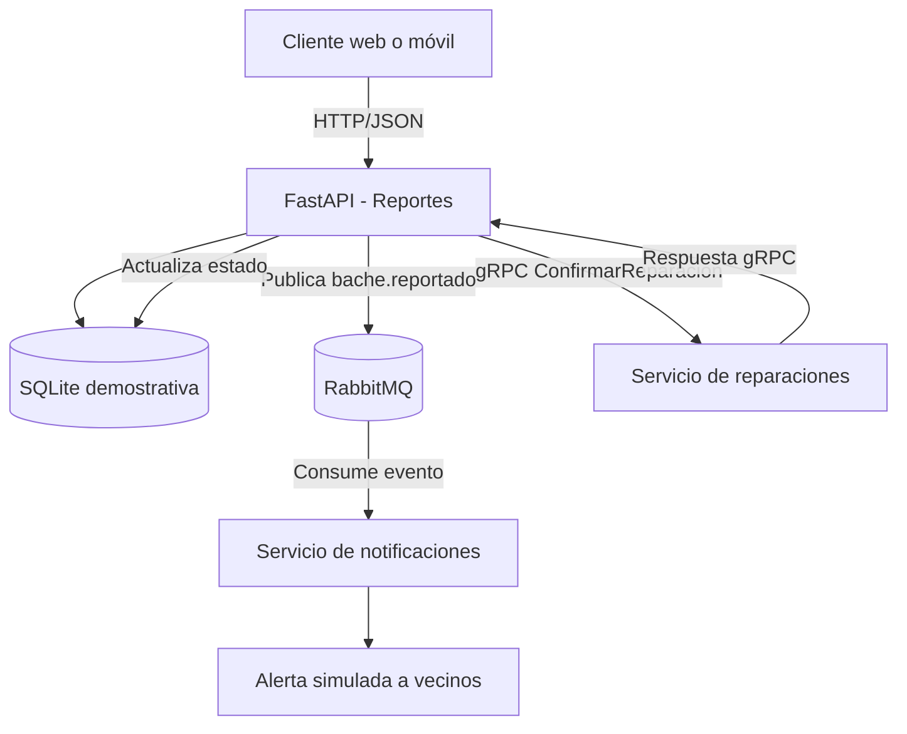

# INFORME DE LABORATORIO
## Sistema distribuido de reporte de baches en Cochabamba

**Asignatura:** __________________________  
**Estudiante:** __________________________  
**Docente:** _____________________________  
**Fecha:** _______________________________

## 1. Introducción
El Gobierno Autónomo Municipal de Cochabamba requiere una solución distribuida para registrar baches, notificar a los vecinos y confirmar reparaciones. El prototipo combina FastAPI para la API REST, RabbitMQ para mensajería asíncrona y gRPC para la comunicación con el servicio de reparaciones.

## 2. Objetivo
Diseñar e implementar un prototipo que registre reportes, publique eventos de notificación y confirme reparaciones mediante gRPC.

## 3. Diagrama arquitectónico


### Endpoints REST
| Método | Endpoint | Descripción |
|---|---|---|
| GET | `/health` | Estado de la API |
| POST | `/reportes` | Registra bache y publica evento |
| GET | `/reportes` | Lista reportes |
| GET | `/reportes/{id}` | Consulta reporte |
| POST | `/reparaciones/{id}/confirmar` | Confirma reparación vía gRPC |

## 4. Flujo del sistema
1. El ciudadano registra un bache mediante `POST /reportes`.
2. FastAPI valida los campos y guarda el reporte en SQLite.
3. La API publica `bache.reportado` en RabbitMQ.
4. El servicio de notificaciones consume el mensaje e imprime una alerta simulada.
5. Cuando la cuadrilla termina el trabajo, se llama a `POST /reparaciones/{id}/confirmar`.
6. FastAPI invoca por gRPC el método `ConfirmarReparacion`.
7. Si la respuesta es exitosa, el reporte se actualiza a `reparado`.

## 5. Justificación de arquitectura
Se propone una arquitectura de microservicios organizada con criterios de arquitectura hexagonal (puertos y adaptadores). Cada servicio tiene una responsabilidad concreta: reportes administra la información, notificaciones procesa eventos y reparaciones confirma trabajos.

RabbitMQ desacopla temporalmente productor y consumidor: el servicio de reportes no necesita esperar a que se procese la notificación. gRPC define un contrato explícito en `reparaciones.proto` y permite llamadas internas tipadas. La API REST facilita la integración con clientes web o móviles.

La implementación es un prototipo compacto que sigue estos criterios, no una separación hexagonal completa en módulos de dominio, puertos y adaptadores independientes.

## 6. Principio abierto/cerrado (OCP)
OCP significa que el software debe permitir extender comportamientos sin modificar innecesariamente el código estable. El evento `bache.reportado` permite incorporar otros consumidores —por ejemplo, estadísticas o un panel municipal— sin cambiar el endpoint productor. También podrían añadirse canales de notificación detrás de una interfaz común, como correo, SMS o notificación móvil. Estos canales adicionales son propuestas de extensión, no funciones implementadas en este prototipo.

## 7. Principio de segregación de interfaces (ISP)
ISP establece que un componente no debe depender de métodos que no utiliza. El cliente REST trabaja con endpoints de reportes; el consumidor RabbitMQ solo necesita el evento publicado; y el cliente gRPC depende únicamente del contrato `ReparacionesService` y del método `ConfirmarReparacion`. Los mensajes gRPC contienen solo los datos necesarios para esta operación.

## 8. Tecnologías
- **FastAPI:** endpoints REST, validación y documentación Swagger.
- **RabbitMQ:** intercambio de eventos y cola durable.
- **gRPC:** contrato de solicitud/respuesta para confirmación.
- **SQLite:** almacenamiento simple para la demostración.
- **Docker Compose:** orquestación de contenedores.

## 9. Pruebas
1. Abrir `http://localhost:8000/docs`.
2. Probar `GET /health`.
3. Ejecutar `POST /reportes` con ubicación, descripción, severidad y nombre del reportante.
4. Consultar `GET /reportes`.
5. Revisar los logs de `notifications` para observar la alerta.
6. Ejecutar `POST /reparaciones/{id}/confirmar` con el ID generado.
7. Consultar de nuevo el reporte y comprobar que `estado` sea `reparado`.

Ejemplo de reporte:
```json
{
  "ubicacion": "Av. América y Beijing",
  "descripcion": "Bache en el carril derecho",
  "severidad": "alta",
  "reportado_por": "Vecino 001"
}
```

Ejemplo de confirmación:
```json
{
  "reparado_por": "Cuadrilla Municipal 3",
  "observacion": "Bache rellenado y superficie nivelada"
}
```

## 10. Resultados esperados
El sistema permite registrar y consultar reportes, publicar un evento que consume el servicio de notificaciones y confirmar una reparación por gRPC. Si RabbitMQ no está disponible, el reporte se guarda, pero el resultado informa que no se publicó el evento; en producción convendría aplicar el patrón Outbox para evitar perder eventos.

## 11. Limitaciones y mejoras
Las alertas se simulan en consola y no se envían mensajes reales. La confirmación gRPC no valida evidencia física. Para producción se recomienda PostgreSQL, autenticación, autorización por roles, TLS, auditoría, métricas, copias de seguridad, reintentos, cola de mensajes fallidos y consistencia transaccional entre la base y el broker. El canal gRPC de demostración no utiliza TLS.

## 12. Conclusión
El laboratorio combina REST para la interacción con clientes, RabbitMQ para eventos asíncronos y gRPC para una operación interna tipada. La separación de responsabilidades favorece el mantenimiento y la escalabilidad. OCP se refleja en la posibilidad de agregar consumidores al evento, mientras ISP se observa en contratos pequeños y específicos por servicio.

## 13. Referencias
- FastAPI: https://fastapi.tiangolo.com/
- RabbitMQ: https://www.rabbitmq.com/tutorials
- gRPC: https://grpc.io/docs/
- Martin, R. C. *Agile Software Development: Principles, Patterns, and Practices*. Prentice Hall, 2002.
